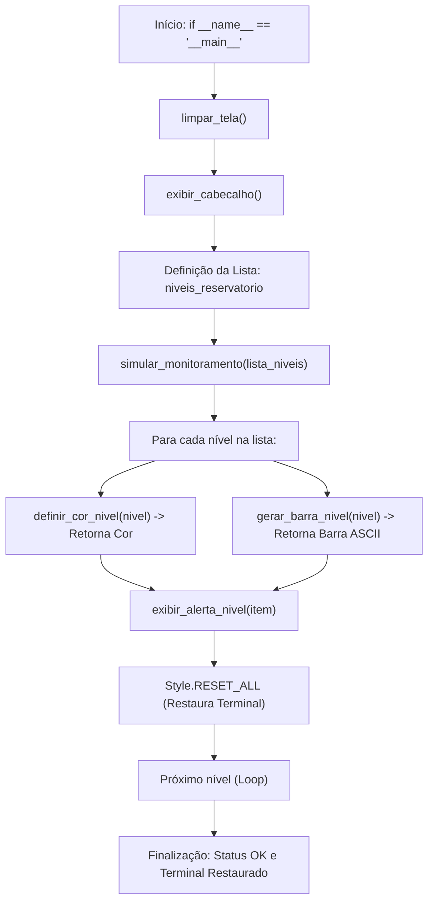

# 💧 Sistema de Monitoramento de Níveis de Água - Reservatório

[](https://www.python.org/)
[](https://pypi.org/project/colorama/)
[](LICENSE)
[]()

> **Componente Curricular:** Desenvolvimento de Sistemas I (DS I)  
> **Instituição:** ETEC / Centro Paula Souza (CPS)  
> **Agenda:** 11 — Estruturas de Dados (Listas), Funções e Bibliotecas de Terminal (`colorama`)  
> **Estudante:** Iraci Berto Gomes  
> **Arquivo de Entrega:** `IraciBertoGomes_Ag11_DSI.py`

---

## 📌 1. Visão Geral do Projeto

Este projeto consiste em um software de **telemetria e monitoramento em tempo real de reservatórios de água**, desenvolvido para execução em linha de comando (terminal). 

O sistema simula um ambiente industrial de controle de níveis de água, avaliando o volume do reservatório em **5 níveis progressivos de criticidade**. A cada nível, o operador recebe um alerta visual enriquecido por cores padronizadas via biblioteca `colorama`, escala gráfica percentual e diagnóstico operacional do sistema hidráulico, restaurando sempre as propriedades originais do terminal após cada ciclo.

---

## 🎯 2. Tabela Oficial de Níveis e Cores de Alerta

Conforme as diretrizes da atividade, o sistema implementa a seguinte escala cromática e de risco:

| Nível do Reservatório | Situação Operacional | Cor Sugerida (`colorama`) | Código ANSI | Ação Automática do Sistema |
| :---: | :--- | :---: | :---: | :--- |
| **Nível 1** | **Muito baixo (crítico)** | **Vermelho** | `Fore.RED` | Válvulas de emergência abertas; risco de desabastecimento. |
| **Nível 2** | **Baixo** | **Amarelo** | `Fore.YELLOW` | Bomba de captação secundária acionada; atenção para reposição. |
| **Nível 3** | **Médio** | **Verde** | `Fore.GREEN` | Capacidade estável; volume ideal para consumo planejado. |
| **Nível 4** | **Alto** | **Ciano** | `Fore.CYAN` | Reservatório com margem ampla; entrada reduzida a 50%. |
| **Nível 5** | **Muito alto (alerta)** | **Azul** | `Fore.BLUE` | Capacidade máxima atingida; vertedouro acionado contra transbordamento. |

---

## 🏗️ 3. Estrutura Arquitetural do Código

O projeto foi codificado respeitando as boas práticas de **Programação Estruturada** e o **Princípio da Responsabilidade Única (SRP)**:



### Funções e Procedimentos Implementados:

1. **`limpar_tela()`** *(Procedimento)*: Limpeza limpa e multiplataforma do console (`cls` no Windows / `clear` no Linux/Unix).
2. **`exibir_cabecalho()`** *(Procedimento)*: Exibição estilizada da interface de telemetria.
3. **`definir_cor_nivel(nivel)`** *(Função com retorno)*: Mapeia puramente o número do nível para a cor ANSI correspondente do `colorama`.
4. **`gerar_barra_nivel(nivel, max_nivel=5)`** *(Função utilitária)*: Converte o nível discreto em uma barra visual de escala ASCII (ex: `[###--] 60%`).
5. **`exibir_alerta_nivel(item_reservatorio)`** *(Procedimento)*: Formata a saída combinando cor, texto e a restauração explícita (`Style.RESET_ALL`).
6. **`simular_monitoramento(lista_niveis, intervalo_segundos)`** *(Procedimento)*: Itera sobre a lista com temporização realista de telemetria.

---

## 💻 4. Evidência de Execução no Terminal

```text
====================================================================
      SISTEMA DE MONITORAMENTO DE NÍVEIS DE ÁGUA - RESERVATÓRIO
             Telemetria e Controle de Risco Operacional
====================================================================

Iniciando ciclo de telemetria e diagnóstico dos sensores...

--------------------------------------------------------------------
>> Nível 1: Muito baixo (crítico)  Escala: [#----]  20%   | Status: Válvulas de emergência abertas. Risco iminente de desabastecimento.
>> Nível 2: Baixo                  Escala: [##---]  40%   | Status: Bomba de captação secundária acionada. Atenção para reposição.
>> Nível 3: Médio                  Escala: [###--]  60%   | Status: Capacidade estável. Volume ideal para consumo planejado.
>> Nível 4: Alto                   Escala: [####-]  80%   | Status: Reservatório com margem ampla. Entrada de água operando em 50%.
>> Nível 5: Muito alto (alerta)    Escala: [#####] 100%   | Status: Capacidade máxima atingida! Vertedouro ativado contra transbordamento.
--------------------------------------------------------------------

[OK] Ciclo de monitoramento concluido com sucesso!
Estilo padrao do terminal restaurado com sucesso.
```

---

## 🚀 5. Como Executar o Projeto

### Pré-requisitos
- Python 3.8 ou superior instalado.
- Terminal com suporte a códigos ANSI (CMD, PowerShell, Windows Terminal ou Bash).

### Passo 1: Clonar o Repositório
```bash
git clone https://github.com/SEU_USUARIO/SEU_REPOSITORIO.git
cd AGENDA_11
```

### Passo 2: Instalar a Biblioteca `colorama`
```bash
pip install -r requirements.txt
# Ou diretamente:
pip install colorama
```

### Passo 3: Executar o Programa
```bash
python IraciBertoGomes_Ag11_DSI.py
```

---

## 🎓 6. Competências e Habilidades Atendidas

- **Competência 4:** Elaborar sistemas aplicando princípios e paradigmas de programação.
- **Habilidade 4.1:** Codificar programas, utilizando técnica de programação estruturada (decomposição funcional, passagem de parâmetros e escopo local).
- **Habilidade 4.2:** Depurar e versionar programas, utilizando ambiente de desenvolvimento integrado (Git, GitHub e controle de versão semântico).
