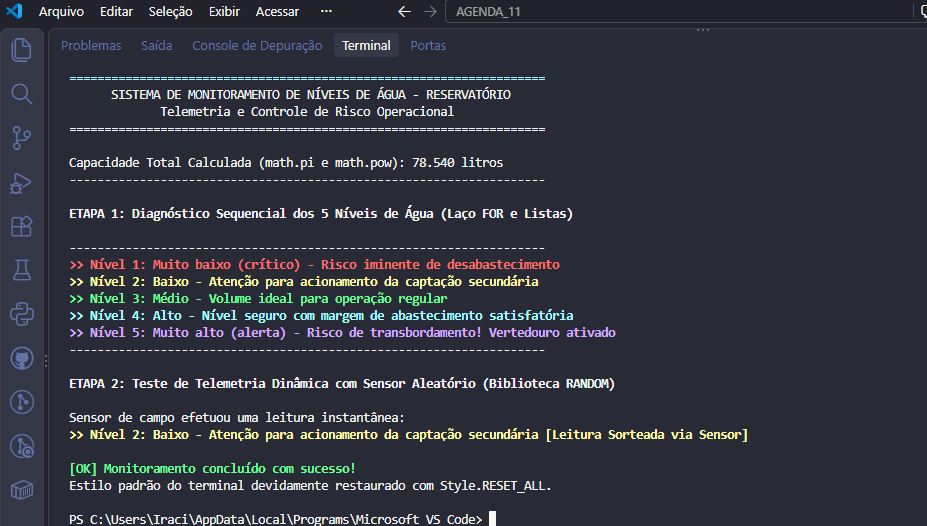

<div align="center">

# 🚰 Sistema de Monitoramento de Níveis de Água
### 💧 Telemetria e Controle Automatizado de Reservatório 💧

```text
       _______________________
      /                       \
     |   RESERVATÓRIO SMART    |
     |=========================|
     | [5] ############### 100%|  -> AZUL (Alerta Máximo)
     | [4] ############---  80%|  -> CIANO (Nível Alto)
     | [3] #########------  60%|  -> VERDE (Nível Médio)
     | [2] ######---------  40%|  -> AMARELO (Nível Baixo)
     | [1] ###------------  20%|  -> VERMELHO (Nível Crítico)
     |=========================|
     \_________________________/
                 | |
             [ VÁLVULA ]
```

[](https://www.python.org/)
[](https://docs.python.org/3/library/math.html)
[](https://docs.python.org/3/library/random.html)
[](https://pypi.org/project/colorama/)
[](https://www.cps.sp.gov.br/)
[](LICENSE)
[]()

**Desenvolvimento de Sistemas I — Agenda 11 | ETEC / CPS**  
**Estudante:** Iraci Berto Gomes | **Script:** `IraciBertoGomes_Ag11_DSI.py`

</div>

---

## 📌 Sobre o Projeto

Software desenvolvido em Python para telemetria automatizada de reservatório industrial:
- **Cálculo Volumétrico (`math`):** Cálculo de capacidade cilíndrica com `math.pi` e `math.pow()`.
- **Diagnóstico Sequencial (`for` + Listas):** Varredura dos 5 níveis com intervalo via `time.sleep()`.
- **Telemetria Instantânea (`random`):** Sorteio de leitura oscilatória via `random.randint()`.
- **Sinalização Visual (`colorama`):** Cores padronizadas por nível com restauração via `Style.RESET_ALL`.

---

## 🎯 Tabela de Níveis e Cores

| Nível | Situação Operacional | Cor Colorama |
| :---: | :--- | :--- |
| **1** | Muito baixo (crítico) - Risco iminente de desabastecimento | `Fore.RED` (🔴 $\color{red}\textbf{Vermelho}$) |
| **2** | Baixo - Atenção para acionamento da captação secundária | `Fore.YELLOW` (🟡 $\color{#D4AC0D}\textbf{Amarelo}$) |
| **3** | Médio - Volume ideal para operação regular | `Fore.GREEN` (🟢 $\color{green}\textbf{Verde}$) |
| **4** | Alto - Nível seguro com margem de abastecimento satisfatória | `Fore.CYAN` (🔷 $\color{#00bcd4}\textbf{Ciano}$) |
| **5** | Muito alto (alerta) - Risco de transbordamento! Vertedouro ativado | `Fore.BLUE` (🔵 $\color{blue}\textbf{Azul}$) |

---

## 💻 Evidência de Execução no Terminal



```text
====================================================================
      SISTEMA DE MONITORAMENTO DE NÍVEIS DE ÁGUA - RESERVATÓRIO
             Telemetria e Controle de Risco Operacional
====================================================================

Capacidade Total Calculada (math.pi e math.pow): 78.540 litros
--------------------------------------------------------------------

ETAPA 1: Diagnóstico Sequencial dos 5 Níveis de Água (Laço FOR e Listas)

--------------------------------------------------------------------
>> Nível 1: Muito baixo (crítico) - Risco iminente de desabastecimento
>> Nível 2: Baixo - Atenção para acionamento da captação secundária
>> Nível 3: Médio - Volume ideal para operação regular
>> Nível 4: Alto - Nível seguro com margem de abastecimento satisfatória
>> Nível 5: Muito alto (alerta) - Risco de transbordamento! Vertedouro ativado
--------------------------------------------------------------------

ETAPA 2: Teste de Telemetria Dinâmica com Sensor Aleatório (Biblioteca RANDOM)

Sensor de campo efetuou uma leitura instantânea:
>> Nível 4: Alto - Nível seguro com margem de abastecimento satisfatória [Leitura Sorteada via Sensor]

[OK] Monitoramento concluído com sucesso!
Estilo padrão do terminal devidamente restaurado com Style.RESET_ALL.
```

---

## 🚀 Como Executar

```bash
# Instalar a biblioteca de cores
pip install colorama

# Executar o script
python IraciBertoGomes_Ag11_DSI.py
```
